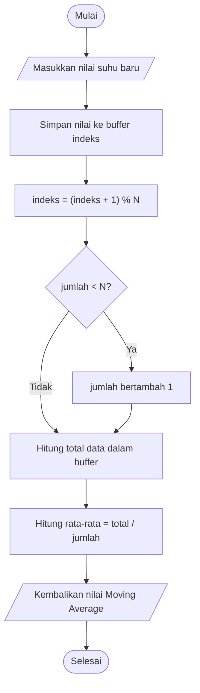

# Modul 5A – Pengolahan Data Suhu pada Mikrokontroler (Moving Average)

**Mata Kuliah:** TK245005 | **Semester:** 2026/5 | **Praktikan:** Kaira Meilasya Nayada (H1H024020)

---

## 1. Detail Percobaan

Percobaan pertama (5A) bertujuan untuk memahami proses pengolahan data suhu menggunakan mikrokontroler, meliputi pembacaan suhu mentah, perhitungan **Moving Average** dari maksimal lima pembacaan terakhir, serta penentuan nilai suhu **minimum** dan **maksimum**. Sensor DHT22 digantikan oleh fungsi suhu **mock** (`bacaSuhuMock()`) sehingga proses pengolahan data dan deteksi anomali dapat dipelajari tanpa pembacaan sensor fisik secara langsung.

### Rangkaian

| No | Komponen | Keterangan |
|---|---|---|
| 1 | ESP8266 (NodeMCU) | Dipasang pada breadboard |
| 2 | Kabel USB | Sumber daya dan komunikasi Serial Monitor |
| 3 | Sensor suhu | Tidak digunakan, diganti fungsi `bacaSuhuMock()` |

## 2. Library / Dependencies yang Diperlukan

| Library | Fungsi |
|---|---|
| `math.h` | Fungsi matematika `sin()` untuk membangkitkan suhu dasar pada fungsi mock |

Tidak diperlukan library tambahan karena percobaan ini tidak menggunakan WiFi maupun MQTT.

## 3. Penjelasan Code

### 3.1 Fungsi `bacaSuhuMock()`

Pengganti sensor DHT22. Setiap dipanggil, `jumlahBaca` bertambah, lalu suhu dibentuk dari:

1. **Suhu dasar:** `28.0 + 2.0 * sin(jumlahBaca * 0.08)` sehingga suhu naik-turun secara bertahap.
2. **Noise:** `random(-5, 6) * 0.1` untuk menyimulasikan fluktuasi acak.
3. **Anomali:** setiap pembacaan kelipatan 25 (`jumlahBaca % 25 == 0`), suhu ditambah `8.0` sebagai lonjakan.

### 3.2 Variabel Buffer & Min/Max

```cpp
const int N = 5;      // jumlah maksimal data yang dirata-ratakan
float buffer[N];      // menyimpan data suhu sebelumnya
int indeks = 0;       // posisi penyimpanan data berikutnya
int jumlah = 0;       // jumlah data yang sudah tersimpan
float suhuMin = 1000.0;
float suhuMax = -1000.0;
```

`suhuMin` dan `suhuMax` diberi nilai ekstrem awal agar pembacaan pertama pasti menggantikannya.

### 3.3 Fungsi `hitungMovingAverage()`

1. Menyimpan suhu baru ke `buffer[indeks]`.
2. Menggeser indeks secara melingkar: `indeks = (indeks + 1) % N` (circular buffer).
3. Menambah `jumlah` jika belum mencapai `N`.
4. Menjumlahkan seluruh data dalam buffer, lalu mengembalikan `total / jumlah`.

### 3.4 Fungsi `setup()`

Dijalankan sekali saat ESP8266 menyala/reset:

1. `Serial.begin(115200)`.
2. `randomSeed(analogRead(A0))` agar noise berbeda setiap kali dinyalakan.
3. Menampilkan pesan awal `Simulasi Pengolahan Data Suhu ESP8266`.

### 3.5 Fungsi `loop()`

1. Mengambil suhu dari `bacaSuhuMock()`.
2. Menghitung rata-rata bergerak dengan `hitungMovingAverage()`.
3. Memperbarui `suhuMin` dan `suhuMax`.
4. Menampilkan `Mentah | Filter | Min | Max` ke Serial Monitor.
5. `delay(2000)` sebelum pembacaan berikutnya.

## 4. Penjelasan Percabangan / Conditional

| Percabangan | Lokasi | Penjelasan |
|---|---|---|
| `if (jumlahBaca % 25 == 0)` | `bacaSuhuMock()` | Menambah suhu `8.0` setiap 25 pembacaan sebagai anomali buatan. |
| `if (jumlah < N) jumlah++` | `hitungMovingAverage()` | Menambah jumlah data hingga maksimal `N`, sehingga rata-rata awal dihitung dari data yang tersedia saja. |
| `for (int i = 0; i < jumlah; i++)` | `hitungMovingAverage()` | Menjumlahkan data yang valid dalam buffer. |
| `if (suhu < suhuMin) suhuMin = suhu` | `loop()` | Memperbarui suhu minimum jika ditemukan nilai lebih rendah. |
| `if (suhu > suhuMax) suhuMax = suhu` | `loop()` | Memperbarui suhu maksimum jika ditemukan nilai lebih tinggi. |

## 5. Hasil Pengamatan (Ringkasan)

Pengamatan dilakukan sebanyak 5 kali pembacaan dengan interval 2 detik.

| No | Waktu Pengiriman (s) | Suhu Mentah (°C) | Moving Average (°C) | Suhu Minimum (°C) | Suhu Maksimum (°C) |
|---|---|---|---|---|---|
| 1 | 2 | 28,16 | 28,57 | 28,16 | 37,62 |
| 2 | 4 | 28,40 | 28,53 | 28,16 | 37,62 |
| 3 | 6 | 27,84 | 28,28 | 27,84 | 37,62 |
| 4 | 8 | 27,78 | 28,12 | 27,78 | 37,62 |
| 5 | 10 | 27,52 | 27,94 | 27,52 | 37,62 |

## 6. Modifikasi Program

Sesuai jawaban pertanyaan praktikum poin 4, ditambahkan fungsi `hitungSimpanganBaku()` yang menghitung simpangan baku (populasi) dari data di dalam buffer, lalu ditampilkan bersama Moving Average:

```cpp
#include <math.h>

const int N = 5;
float buffer[N];
int indeks = 0;
int jumlah = 0;

float hitungSimpanganBaku() {
  if (jumlah < 2) return 0.0;

  float total = 0.0;
  // Menghitung rata-rata data dalam buffer
  for (int i = 0; i < jumlah; i++) {
    total += buffer[i];
  }
  float rataRata = total / jumlah;

  // Menghitung jumlah kuadrat selisih dari rata-rata
  float totalKuadrat = 0.0;
  for (int i = 0; i < jumlah; i++) {
    float selisih = buffer[i] - rataRata;
    totalKuadrat += selisih * selisih;
  }

  // Menghitung simpangan baku populasi
  float varians = totalKuadrat / jumlah;
  return sqrt(varians);
}

float hitungMovingAverage(float nilaiBaru) {
  // Menyimpan data baru pada posisi indeks saat ini
  buffer[indeks] = nilaiBaru;

  // Memindahkan indeks dan kembali ke awal jika mencapai N
  indeks = (indeks + 1) % N;

  // Menghitung jumlah data yang sudah tersedia
  if (jumlah < N) jumlah++;

  float total = 0.0;
  for (int i = 0; i < jumlah; i++) {
    total += buffer[i];
  }
  float rataRata = total / jumlah;

  // Menghitung simpangan baku dari data dalam buffer
  float simpanganBaku = hitungSimpanganBaku();

  // Menampilkan hasil pengolahan melalui Serial Monitor
  Serial.print("Moving Average: ");
  Serial.print(rataRata, 2);
  Serial.print(" | Simpangan Baku: ");
  Serial.println(simpanganBaku, 2);

  return rataRata;
}
```

## 7. Jawaban Pertanyaan Praktikum (Terkait Code)

1. **Flowchart proses Moving Average:**



2. **Fungsi operasi `(indeks + 1) % N`:** menjaga posisi indeks buffer tetap berada dalam rentang 0 sampai N−1. Operator `%` (modulus) menghasilkan sisa pembagian. Contoh untuk N = 5: urutan indeks adalah 0, 1, 2, 3, 4. Ketika indeks mencapai 4, operasi `(4 + 1) % 5` menghasilkan 0 sehingga indeks kembali ke awal buffer. Mekanisme ini disebut **circular buffer** (buffer melingkar).

3. **Dampak perubahan nilai N:**
   - **N = 20:** Moving Average memakai hingga 20 data terakhir. Hasil filter lebih halus karena perubahan mendadak lebih teredam, tetapi respons terhadap perubahan suhu menjadi lebih lambat.
   - **N = 2:** Moving Average memakai hingga 2 data terakhir. Filter lebih cepat mengikuti perubahan suhu, tetapi lebih mudah terpengaruh fluktuasi atau noise.

   Jadi, semakin besar N, semakin halus hasil filter tetapi semakin lambat responsnya. Sebaliknya, semakin kecil N, semakin cepat responsnya tetapi hasil filter cenderung lebih berfluktuasi.

4. **Modifikasi program:** penambahan perhitungan simpangan baku dari data pada buffer (lihat bagian 6).

## 8. Kendala

Pada awal percobaan tidak ada kendala yang berarti.
